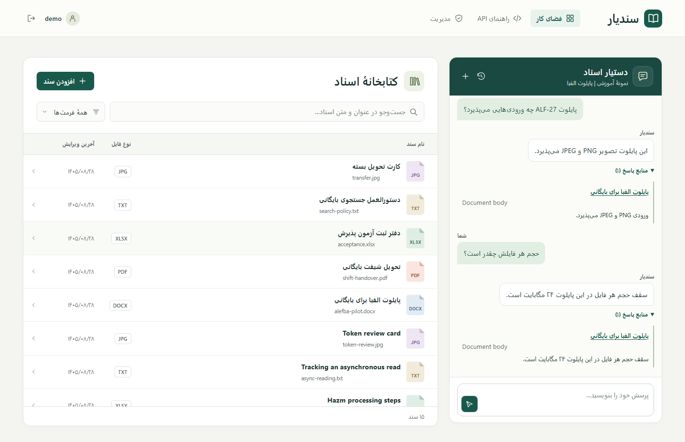

# سندیار | پرسش از اسناد روشن

یک برنامهٔ Django برای بارگذاری سند، جست‌وجو و گفت‌وگوی مستند به فارسی و انگلیسی. در دسکتاپ، کتابخانه سمت چپ و دستیار سمت راست است. روی موبایل می‌توانید بین این دو بخش جابه‌جا شوید. حساب اصلی دمو با ۱۵ سند و یک گفت‌وگوی آموزشیِ ازپیش‌نوشته‌شده باز می‌شود.

## ۱. آماده کردن Docker در ویندوز

1. Docker Desktop را نصب کنید. در نصب، موتور WSL 2 و Linux containers را انتخاب کنید. اگر برنامه درخواست کرد Windows را دوباره راه‌اندازی کنید. [راهنمای رسمی نصب Docker Desktop](https://docs.docker.com/desktop/setup/install/windows-install/)
2. Docker Desktop را باز کنید و صبر کنید تا موتور آماده شود.
3. ZIP را کامل Extract کنید یا مخزن GitHub را clone کنید. پوشه‌ای را باز کنید که فایل‌های `manage.py` و `docker-compose.yml` در آن قرار دارند. در ویندوز می‌توانید پروژه را در `C:\Work\Roshan` قرار دهید. برای باز کردن PowerShell در همان پوشه، در نوار آدرس File Explorer بنویسید `powershell` و Enter بزنید.
4. این دو دستور را جداگانه اجرا کنید. دستور دوم باید بخش **Server** را هم نشان دهد.

~~~powershell
docker compose version
docker version
~~~

## ۲. حساب رایگان و کلید OpenRouter

1. در OpenRouter روی **Sign up** یا **Sign in** بزنید. می‌توانید با حساب Google وارد شوید. [OpenRouter](https://openrouter.ai/)
2. بخش **API keys** را باز کنید و **New key** یا **Create key** را بزنید. نامی مثل `Roshan Intern Demo` و مهلتی مناسب ارائه انتخاب کنید. برای سقف هزینه، **Custom amount** و **0** را انتخاب کنید. [مدیریت کلیدها](https://openrouter.ai/settings/keys)
3. بعد از **Create** کلید را همان لحظه کپی کنید. سقف اعتبار در این فرم بودجهٔ مجاز برای هزینه است. مدل‌های دارای پسوند `:free` و مسیر `openrouter/free` برای این دمو انتخاب شده‌اند. سهمیه و ظرفیت در اختیار OpenRouter است. [مدل‌های رایگان](https://openrouter.ai/collections/free-models)
4. برای راه‌اندازی روی رایانهٔ جدید، در PowerShell این دستورها را اجرا کنید.

~~~powershell
Copy-Item .env.example .env
notepad .env
~~~

5. داخل فایل، کلید را پس از علامت مساوی در خط `OPENROUTER_API_KEY=` بگذارید و ذخیره کنید. رمزهای `DEMO_PASSWORD` و `REVIEWER_PASSWORD` را هم می‌توانید **پیش از اولین اجرا** انتخاب کنید. فایل نمونه برای اجرای محلی رمز پیش‌فرض دارد. نسخهٔ ارسالی پروژه فقط `.env.example` دارد. اگر از قبل فایل شخصی `.env` دارید، همان را کنار `manage.py` بگذارید.
6. اگر در آینده کلید یا شناسهٔ مدل را تغییر دادید، این دستور تنظیمات جدید را اعمال می‌کند.

~~~powershell
docker compose up -d --force-recreate
~~~

مدل پیش‌فرض `baidu/ernie-5.5-flash-preview:free` است. مسیر جایگزین `openrouter/free` در صورت خطای مدل یا پاسخ ساختاری نامعتبر امتحان می‌شود. امکان انتخاب مدل در `.env` وجود دارد. [صفحهٔ مدل پیش‌فرض](https://openrouter.ai/baidu/ernie-5.5-flash-preview:free)

## ۳. اجرای پروژه

~~~powershell
docker compose up -d --build
docker compose ps
~~~

ساخت اول به اینترنت نیاز دارد. Docker بسته‌های Python، OCR فارسی و انگلیسی و حدود ۲۵۲ مگابایت فایل مدل چندزبانه را دریافت می‌کند. مدل CPU داخل image ذخیره می‌شود. وقتی وضعیت سرویس `healthy` شد، مرورگر را باز کنید.

| مسیر | کاربرد |
|---|---|
| [فضای کار](http://localhost:8000/) | مدیریت سند و گفت‌وگو |
| [پنل Django Admin](http://localhost:8000/admin/) | مدیریت اسناد خود، ثبت پرسش و دیدن تاریخچه |
| [راهنمای API در برنامه](http://localhost:8000/api/docs/) | مسیرها و نحوهٔ احراز هویت |

| نام کاربری | رمز اولیهٔ فایل نمونه | داده و دسترسی |
|---|---|---|
| `demo` | `Roshan-Demo-27` | ۱۵ سند، یک گفت‌وگوی آموزشی و دسترسی به Admin |
| `reviewer` | `Roshan-Review-82` | یک سند خصوصی، فضای کار مستقل |

روی volume تازه، پایگاه دادهٔ ازپیش‌نمایه‌شده کپی و رمز دو حساب از `.env` تنظیم می‌شود. داده‌ها و ویرایش‌های بعدی با توقف یا ساخت دوبارهٔ کانتینر باقی می‌مانند.

~~~powershell
docker compose exec web python manage.py test
docker compose logs --tail 40 web
docker compose down
~~~

برای اجرای مجدد کافی است `docker compose up -d` بزنید. برای ساخت ابرمدیر شخصی از دستور زیر استفاده کنید. حساب جدید کتابخانهٔ خالی خودش را دارد. از بخش کاربران Admin می‌توانید حساب بسازید، فعال یا غیرفعال کنید و دسترسی پنل بدهید.

~~~powershell
docker compose exec web python manage.py createsuperuser
~~~

## ۴. اولین آزمایش

1. با `demo` وارد شوید. در کتابخانه `ALF-27` را جست‌وجو و سند «پایلوت الفبا برای بایگانی» را باز کنید. در متن آن فرمت‌های PNG و JPEG و سقف آزمایشی ۲۴ مگابایت آمده است.
2. یک گفت‌وگوی تازه بسازید و بپرسید «پایلوت ALF-27 چه فرمت‌هایی می‌پذیرد؟». روی منبع پاسخ کلیک کنید تا متن سند باز شود.
3. در **همان گفت‌وگو** بنویسید «سقف حجمش چقدر است؟ به انگلیسی جواب بده.» انتظار می‌رود پاسخ انگلیسی با عدد **24 MB** و شاهد عین سند بیاید.
4. برای تست PDF ترکیبی بپرسید «شیفت SHIFT-92 چه ساعتی تحویل می‌شود؟». شاهد باید از صفحهٔ دوم با برچسب OCR باشد. برای نبود شواهد بپرسید «بودجه خرید سرور پروژه ZEBRA-909 چقدر بود؟».
5. با `demo` برای `CEDAR-819` جست‌وجو کنید. سپس در یک پنجرهٔ خصوصی با `reviewer` وارد شوید و همان کد را جست‌وجو کنید. فقط حساب دوم یادداشت مربوط را دارد.

## ۵. مسیر کد برای ارائه

| فایل | کاری که انجام می‌دهد |
|---|---|
| `library/models.py` | مالک سند و گفت‌وگو، قطعه و بردار، پرسش و پاسخ و شواهد |
| `library/extraction.py` | استخراج Word، Excel، متن، تصویر و PDF به بخش‌های دارای مکان |
| `library/services.py` | ورود و ویرایش اتمیِ سند و نمایه، ذخیرهٔ پاسخ در نشست درست |
| `library/rag.py` | زنجیرهٔ LangChain، بازنویسی با تاریخچه، بازیابی ترکیبی و بررسی استناد |
| `library/views.py` و `serializers.py` | API، اعتبارسنجی ورودی و محدودکردن داده‌ها به کاربر درخواست |
| `library/admin.py` | فرم بارگذاری، پرسش، شواهد و مدیریت حساب‌ها در Admin |
| `templates/` و `static/app/` | رابط Django با HTML، CSS و JavaScript ساده |
| `scripts/generate_samples.py` و `library/management/commands/seed_demo.py` | تولید فایل‌ها و بارگذاری از مسیر واقعی استخراج و نمایه‌سازی |

در ورود سند، هر صفحهٔ PDF جداگانه بررسی می‌شود. صفحات دارای متن مستقیم خوانده می‌شوند. صفحات تصویری و فایل‌های PNG و JPEG به Tesseract با زبان‌های `fas+eng` داده می‌شوند. متن کامل در SQLite و قطعه‌های دارای مکان و بردار در جدول `Chunk` ذخیره می‌شوند. ویرایش دستی متن جایگزین متن و نمایه می‌شود و مکان جدید «متن ویرایش‌شده» می‌گیرد. تاریخچه، نقل‌قول زمان پاسخ را نگه می‌دارد.

در هر سؤال، ابتدا قطعه‌های متعلق به همان کاربر انتخاب می‌شوند. LangChain حداکثر چهار نوبت اخیر همان گفت‌وگو را برای مستقل کردن سؤال و تولید عبارت جست‌وجوی دوم به مدل می‌دهد. بازیابی برای سؤال جدید تکرار می‌شود. شباهت کسینوسی بردارهای چندزبانه و امتیاز BM25 جدا محاسبه می‌شوند. رتبه‌ها با Reciprocal Rank Fusion ادغام می‌شوند و همسایه‌های قطعه‌های منتخب نیز به مدل می‌رسند. دستور زبانِ پاسخ بر زبان سؤال اولویت دارد. مدل برای هر ادعا جمله، شمارهٔ قطعه و نقل‌قول می‌دهد؛ برنامه تطابق نقل‌قول و اعداد را بررسی می‌کند و فقط شواهد معتبر را ثبت می‌کند.

SQLite هم متن و هم بردارهای ۳۸۴بعدی را نگه می‌دارد. جست‌وجوی دقیق NumPy روی مجموعهٔ شخصی کوچک، نصب و توضیح پروژه را ساده می‌کند. با رشد زیاد کتابخانه، بارگذاری همهٔ قطعه‌های یک کاربر در حافظه هزینه‌بر می‌شود. OCR هم به کیفیت اسکن وابسته است. متن بخش‌های بازیابی‌شده و زمینهٔ کوتاه مکالمه برای تولید پاسخ به OpenRouter ارسال می‌شوند. کیفیت معنایی پاسخ همچنان به مدل وابسته است.

## ۶. بازتولید دمو و رفع مشکل

~~~powershell
docker compose exec web python scripts/generate_samples.py
docker compose exec web python manage.py seed_demo
~~~

دستور اول فایل‌های نمونه را دوباره تولید می‌کند. دستور دوم نمونه‌هایی را که برای صاحبشان وجود ندارند وارد می‌کند. برای بازیابی سند نمونه‌ای که عمداً حذف کرده‌اید نیز همین دستور دوم را اجرا کنید. ساخت snapshot اولیه از مسیر واقعی استخراج، OCR و embedding انجام شده است. در `samples/catalog.json` مالک، زبان و منبع عمومی هر نمونه درج شده است. اعداد و شرایط ساخته‌شده با `[داده آزمایشی / Test Data]` مشخص شده‌اند. سقف **۲۴ MB** در پروندهٔ پایلوت یک واقعیت نمایشی است. خود برنامه فایل تا **۲۰ MiB** و PDF تا **۱۰۰ صفحه** می‌پذیرد.

| نشانه | اقدام |
|---|---|
| `docker version` بخش Server ندارد | Docker Desktop را اجرا کنید و تا آماده‌شدن موتور Linux صبر کنید. |
| ساخت در مرحلهٔ دانلود مدل متوقف می‌شود | دسترسی به PyPI و Hugging Face را بررسی و همان دستور build را تکرار کنید. فایل مدل در ساخت از روی SHA-256 بررسی می‌شود. |
| ورود با رمز جدید کار نمی‌کند | رمزهای .env روی پایگاه تازه اعمال می‌شوند. برای پایگاه موجود از `docker compose exec web python manage.py changepassword demo` استفاده کنید. |
| چت خطای سرویس می‌دهد | کلید، انقضا و سهمیهٔ مدل را بررسی کنید. تغییر .env را با دستور بازسازی کانتینر در بخش ۲ اعمال کنید. |
| چت می‌گوید شواهد کافی نیست | متن استخراج‌شده را باز کنید، حساب و سند درست را بررسی کنید و سؤال را دقیق‌تر بپرسید. |

[قرارداد کامل API](docs/API.md) · [چک‌لیست ارائهٔ ۱۰ دقیقه‌ای](docs/PRESENTATION.md) · [اسکرین‌شات واقعی Django Admin](docs/screenshots/django-admin.png)

## نتیجهٔ آزمون تحویل

نسخهٔ استخراج‌شده از ZIP هر ۱۹ تست را گذراند. تست‌ها شامل دسترسی مستقیم ابرمدیر به شناسهٔ سند و گفت‌وگوی دیگران، ویرایش اتمی و حذف سند، محدود بودن تاریخچه به همان نشست، اعتبار نقل‌قول، مسیر جایگزین مدل و OCR واقعی هستند.

در آزمون زنده با OpenRouter، سامانه برای سؤال فارسی فرمت‌های PNG و JPEG را از پروندهٔ ALF-27 یافت. در نوبت بعد، به درخواست انگلیسی، سقف 24 MB را با شاهد برگرداند. در دو سؤال دیگر، ساعت 17:30 UTC از صفحهٔ دوم PDF اسکن‌شده و تاریخ 2026-04-12 از ردیف دوم Excel بازیابی شد. پرسش دربارهٔ پروژهٔ فاقد مدرک پاسخ «اطلاعات کافی یافت نشد» گرفت.

تصویر پروژه با Docker Desktop روی ویندوز ساخته شد و کانتینر `roshan-web-1` شروع به کار کرد. روی سرویس محلی، صفحهٔ ورود و مستندات API پاسخ ۲۰۰ دادند. درخواست‌های احرازشده برای سند و گفت‌وگوی کاربر دیگر پاسخ ۴۰۴ گرفتند. متن OCR و شواهد ذخیره‌شده هم از طریق API همین سرویس بررسی شدند. اجرای مجموعهٔ ۱۹ تست خودکار با Python 3.12 روی ویندوز انجام شد.
